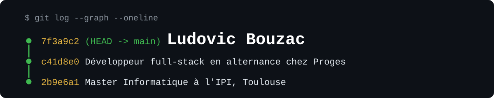
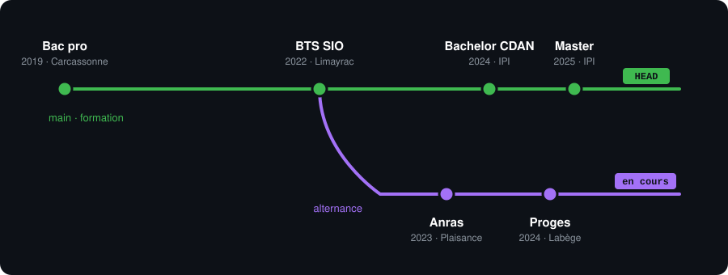
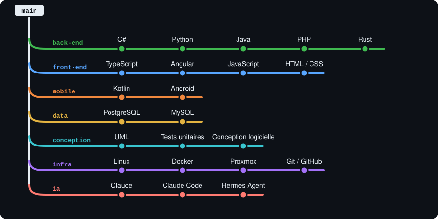

<div align="center">



<br/>


[](https://www.linkedin.com/in/ludovic-bouzac/)
[](mailto:bouzacludovic@gmail.com)

</div>

## `git config --list`

Étudiant en **Master Informatique à l'IPI (Toulouse)** et développeur en alternance chez **Proges**, je conçois des applications complètes, de la base de données à l'interface. Je travaille au quotidien en **C#** et **PostgreSQL**.

Rigoureux et à l'aise en équipe, j'aime comprendre toute la chaîne : du code jusqu'aux réseaux et aux serveurs **Linux** que je fais tourner chez moi sous **Proxmox**. J'intègre l'IA (**Claude**, **Claude Code**, **Hermes Agent**) dans mon workflow pour aller plus vite sans sacrifier la qualité.

```ini
user.name=Ludovic Bouzac
user.role=Développeur full-stack en alternance
user.employer=Proges
user.school=IPI Toulouse (Master Informatique, 2025-2027)
user.stack=C#, PostgreSQL, TypeScript, Python, Rust
user.tools=Linux, Docker, Proxmox, Git, Claude, Hermes Agent
user.languages=français (natif), anglais (B2), italien (A1)
user.location=Toulouse
user.licence=B (véhiculé)
```

## `git log --graph`

<div align="center">



</div>

| Période | Diplôme | Établissement |
| --- | --- | --- |
| 2025 - 2027 | Master Informatique (C#, Java, Kotlin, UML, conception logicielle) | IPI, Toulouse |
| 2024 - 2025 | Bachelor CDAN (Python, Angular, UML, Kotlin, Java), diplôme obtenu | IPI, Toulouse |
| 2022 - 2024 | BTS SIO option SLAM (PHP, Java, SQL, UML), diplôme obtenu | Institut Limayrac, Toulouse |
| 2019 - 2022 | Bac pro Systèmes Numériques option RISC (réseaux), diplôme obtenu | Lycée Jules Fil, Carcassonne |

## `git log --stat`

```text
commit c41d8e0 (HEAD -> main, origin/main)
Author: Ludovic Bouzac <bouzacludovic@gmail.com>
Date:   novembre 2024 - aujourd'hui

    Proges : développeur en alternance (Labège)

    Éditeur de logiciels : évolution du produit et outils internes.

    - Logiciel Proges : conception et développement de fenêtres
      pour la prochaine version
    - Qualité : mise en place de tests unitaires
    - Site web : refonte de plusieurs parties du site de l'entreprise
    - CRM interne : développement d'un CRM d'entreprise (clients,
      devis et leur suivi)
    - Stack : C#, PostgreSQL

commit 5e8c1b3
Author: Ludovic Bouzac <bouzacludovic@gmail.com>
Date:   juillet 2023 - juillet 2024

    Anras DIME Saint-Jean : développeur en alternance (Plaisance-du-Touch)

    - Gestion des horaires : développement d'un site web de suivi des
      variations d'horaire, de la base de données à l'envoi des
      notifications par e-mail
    - Support terrain : interventions sur les différents sites de la
      DIME Saint-Jean pour installer et dépanner des logiciels
    - Stack : PHP, SQL, JavaScript, Composer, sendMail
```

## `git branch -a`

<div align="center">



</div>

## `git ls-tree HEAD projets/`

```text
040000 tree  pve-hub         PWA de gestion Proxmox avec chat Hermes Agent
040000 tree  kermesse-site   Jeu créé sur kermesse.site
```

- [**PVE Hub**](https://github.com/LBouzac/pvehub) : application web (PWA) pour gérer mon serveur **Proxmox** depuis mon téléphone, avec un chat **Hermes Agent** intégré pour piloter le homelab en langage naturel.
- [**kermesse.site**](https://kermesse.site) : jeu que j'ai créé sur le site **kermesse.site**.

## `git remote -v`

| Remote | URL |
| --- | --- |
| `linkedin` | [linkedin.com/in/ludovic-bouzac](https://www.linkedin.com/in/ludovic-bouzac/) |
| `mail` | [bouzacludovic@gmail.com](mailto:bouzacludovic@gmail.com) |
| `github` | [github.com/LBouzac](https://github.com/LBouzac) |

## `git status`

```text
On branch main
Your branch is up to date with 'origin/main'.

nothing to commit, working tree clean
```
