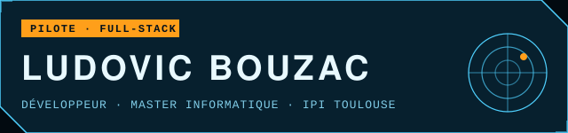
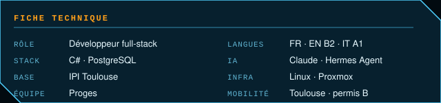
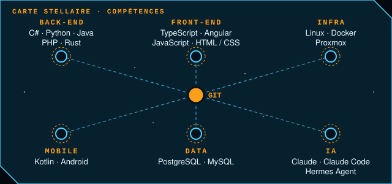
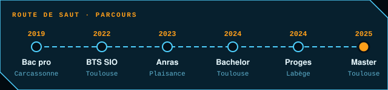

 

## À propos

Étudiant en **Master Informatique à l'IPI (Toulouse)** et développeur en alternance chez **Proges**, je conçois des applications complètes, de la base de données à l'interface. Je travaille au quotidien en **C#** et **PostgreSQL**.

Rigoureux et à l'aise en équipe, j'aime comprendre toute la chaîne : du code jusqu'aux réseaux et aux serveurs **Linux** que je fais tourner chez moi sous **Proxmox**. J'intègre l'IA (**Claude**, **Claude Code**, **Hermes Agent**) dans mon workflow pour aller plus vite sans sacrifier la qualité.

## Carte stellaire

## Route de saut

| Période | Diplôme | Établissement |
| --- | --- | --- |
| 2025 - 2027 | Master Informatique (C#, Java, Kotlin, UML, conception logicielle) | IPI, Toulouse |
| 2024 - 2025 | Bachelor CDAN (Python, Angular, UML, Kotlin, Java), diplôme obtenu | IPI, Toulouse |
| 2022 - 2024 | BTS SIO option SLAM (PHP, Java, SQL, UML), diplôme obtenu | Institut Limayrac, Toulouse |
| 2019 - 2022 | Bac pro Systèmes Numériques option RISC (réseaux), diplôme obtenu | Lycée Jules Fil, Carcassonne |

## Journal de bord

### Proges : développeur en alternance
`Labège  |  novembre 2024 - aujourd'hui`

Éditeur de logiciels : je participe à l'évolution du produit et aux outils internes.

- **Logiciel Proges** : conception et développement de fenêtres pour la prochaine version
- **Qualité** : mise en place de tests unitaires pour fiabiliser le code
- **Site web** : refonte de plusieurs parties du site de l'entreprise
- **CRM interne** : développement d'un CRM d'entreprise pour gérer les clients, les devis et leur suivi
- **Stack** : `C#` · `PostgreSQL`

### Anras DIME Saint-Jean : développeur en alternance
`Plaisance-du-Touch  |  juillet 2023 - juillet 2024`

- **Gestion des horaires** : développement d'un site web de suivi des variations d'horaire, de la base de données à l'envoi des notifications par e-mail
- **Stack** : `PHP` · `SQL` · `JavaScript` · `Composer` · `sendMail`
- **Support terrain** : interventions sur les différents sites de la DIME Saint-Jean pour installer et dépanner des logiciels

## Projets

- [**PVE Hub**](https://github.com/LBouzac/pvehub) : application web (PWA) pour gérer mon serveur **Proxmox** depuis mon téléphone, avec un chat **Hermes Agent** intégré pour piloter le homelab en langage naturel.
- [**kermesse.site**](https://kermesse.site) : jeu que j'ai créé sur le site **kermesse.site**.

## Contact

| Canal | Lien |
| --- | --- |
| LinkedIn | [linkedin.com/in/ludovic-bouzac](https://www.linkedin.com/in/ludovic-bouzac/) |
| E-mail | [bouzacludovic@gmail.com](mailto:bouzacludovic@gmail.com) |
| GitHub | [github.com/LBouzac](https://github.com/LBouzac) |
